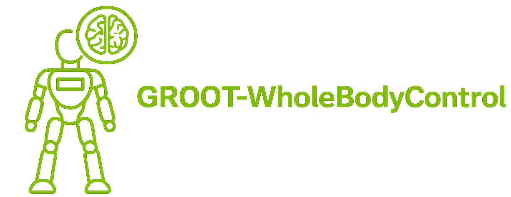
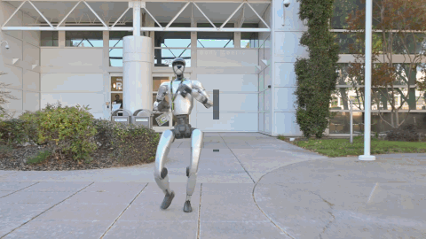

<div align="center">

  

</div>

<div align="center">

[](LICENSE)
[](https://huggingface.co/ClementHW/sonic-x2)
[](https://github.com/NVlabs/GR00T-WholeBodyControl)
[](https://nvlabs.github.io/GR00T-WholeBodyControl/)

</div>

---

# sonic-x2

**GEAR-SONIC whole-body control on the AgiBot X2 humanoid.**

This repository is a fork of NVIDIA's
[GR00T-WholeBodyControl](https://github.com/NVlabs/GR00T-WholeBodyControl),
adapted end-to-end to the AgiBot X2 robot. It adds:

- **X2 policy stack** — SONIC deploy policy (ONNX) plus the kinematic-planner
  checkpoints (CLIP, VQ-VAE, pose, root), published at
  [ClementHW/sonic-x2](https://huggingface.co/ClementHW/sonic-x2) (public).
- **One-command setup** — `install_scripts/setup_x2.sh` creates the venv,
  pulls LFS assets, and downloads all X2 weights from the public HF repo.
- **MuJoCo evaluation** — ONNX-driven X2 rollouts and `.pt`↔ONNX parity
  checks via `gear_sonic/scripts/eval_x2_mujoco_onnx.py`.
- **Real-robot runtime** — the PC2 lifecycle manager
  ([`x2_pc2/x2_stack.sh`](x2_pc2/x2_stack.sh), installed as `./x2`) with
  preflight checks, a deploy safety gate, and graceful handoff back to the
  native motor controller; Pico VR teleoperation.
- **Inherited upstream stacks** — G1 SONIC training/deployment, MotionBricks,
  and Decoupled WBC, unchanged (see
  [Upstream: GEAR-SONIC (G1)](#upstream-gear-sonic-g1)).

## Quick Start (X2)

Validated end-to-end on Ubuntu. No GPU, no docker, and no robot are needed
for anything on this page. Prerequisite: Python 3.10.

```bash
git lfs install
git clone https://github.com/ClementHW/sonic-x2.git
cd sonic-x2
bash install_scripts/setup_x2.sh
```

The setup script is idempotent and runs, in order: LFS pull → `.venv`
(Python 3.10, CPU torch) → validated pip sequence → X2 model download into
the SONIC cache → environment verification. Optional flags: `--with-docker`
(also builds the self-contained X2 sim-deploy image) and `--skip-models`.

The manual step-by-step reference (for debugging a failed step) is
[SETUP.md](SETUP.md).

Sanity-check the deploy artifact in MuJoCo (resolves the policy from the
SONIC cache when `--onnx` is omitted):

```bash
.venv/bin/python gear_sonic/scripts/eval_x2_mujoco_onnx.py
```

## X2 Model Checkpoints

Hosted on Hugging Face — **not** in this git repo (only small assets are
LFS-tracked in git):

| Artifact | Path in [HF repo](https://huggingface.co/ClementHW/sonic-x2) | Size | What it is |
|---|---|---|---|
| SONIC deploy policy | `sonic_policy/x2_sonic_policy.onnx` | 58 MB | ONNX policy run by the C++ deploy stack |
| CLIP encoder | `kplanner_torch/x2_clip.ckpt` | 1.4 MB | Text/command encoder for the kinematic planner |
| VQ-VAE prior | `kplanner_torch/vqvae/` | 272 MB | Latent motion prior (+ hparams, skeleton, stats) |
| Pose decoder | `kplanner_torch/pose/` | 1.5 GB | Latent → pose decoding (+ hparams, skeleton, stats) |
| Root decoder | `kplanner_torch/root/` | 391 MB | Root trajectory decoding (+ hparams, skeleton, stats) |

Manual download (the setup script already does this):

```bash
python download_from_hf.py --robot x2
```

Weights live in the **SONIC model cache**: `$SONIC_HOME/x2`, default
`~/.cache/sonic/x2` (override the root with `SONIC_HOME`, or just the X2
subtree with `SONIC_X2_MODELS`). All stack scripts resolve models from this
cache automatically; flags are only needed to override.

G1 checkpoints (inherited from upstream) come from
[nvidia/GEAR-SONIC](https://huggingface.co/nvidia/GEAR-SONIC):
`python download_from_hf.py` (default), `--low-latency`, or `--training`.

## Real-Robot Operation (X2, PC2 only)

The complete SONIC + Pico teleop stack runs on the robot's PC2. Install
`x2_pc2/x2_stack.sh` as `./x2` under the canonical prefix
(`/agibot/data/home/agi/gear-sonic`), then:

```bash
./x2 preflight
./x2 start     # at the safety gate: robot supported, area clear, e-stop reachable -> y
./x2 status
./x2 logs deploy
./x2 stop      # graceful RAMP_OUT -> MC handoff
```

- **[GUIDE.md](GUIDE.md)** — 中文真机操作指南:Pico 摇杆/按键控制、运行中
  监控、非交互模式与停止流程。
- **[SKILL.md](SKILL.md)** — English operator runbook for the PC2 runtime.
- **[X2 Safety Checks](docs/source/references/x2_safety_checks.md)** —
  e-stop, damping profile, watchdogs, and thermal alerting.

> ⚠️ This is real-hardware operation. Read the safety references before the
> first `./x2 start`, and always confirm the deploy gate manually.

## What's Included

| Directory | What it is |
|---|---|
| `gear_sonic` | SONIC training stack, data processing, and the X2 MuJoCo eval scripts |
| `gear_sonic_deploy` | C++ inference stack (G1 deploy, X2 sim/real deploy configs and docker image) |
| `x2_pc2` | PC2 lifecycle manager (`x2_stack.sh`) and PC2-side teleop helpers |
| `motionbricks` | Inherited: real-time latent generative motion stack (G1) |
| `decoupled_wbc` | Inherited: decoupled WBC (RL lower body + IK upper body) for GR00T N1.5/N1.6 |
| `install_scripts` | `setup_x2.sh` plus per-environment installers (sim, teleop, data collection) |
| `docs` | Upstream documentation source, including the X2 reference pages |

### Which environment do I need?

| I want to... | Environment | How to install |
|---|---|---|
| **Run X2 sim / eval** | `.venv` | `bash install_scripts/setup_x2.sh` |
| **Operate the X2 robot** | PC2 runtime | [Real-Robot Operation](#real-robot-operation-x2-pc2-only) |
| **Train / finetune SONIC (G1)** | Isaac Lab's Python env | [Upstream training docs](https://nvlabs.github.io/GR00T-WholeBodyControl/user_guide/training.html) |
| **G1 MuJoCo simulation** | `.venv_sim` (auto-created) | `bash install_scripts/install_mujoco_sim.sh` |
| **G1 VR teleoperation** | `.venv_teleop` (auto-created) | `bash install_scripts/install_pico.sh` |
| **Collect data (G1)** | `.venv_data_collection` (auto-created) | `bash install_scripts/install_data_collection.sh` |

> MotionBricks pretrained G1 checkpoints are skipped by default to avoid an
> extra ~2.2 GiB download on clone; fetch them explicitly with
> `git lfs pull --include="motionbricks/out/**" --exclude=""` if you need the
> MotionBricks demo.

## Upstream: GEAR-SONIC (G1)

<div align="center">
  
</div>

SONIC is a humanoid behavior foundation model from NVIDIA GEAR that learns a
core set of motor skills from large-scale human motion data: one unified
tracking policy produces natural whole-body movement — walking, crawling,
teleoperation — and generalizes beyond its training motions. The upstream
release includes training code, the C++ deployment framework, G1 checkpoints,
and the teleoperation stack; see the
[whitepaper](https://nvlabs.github.io/GEAR-SONIC/),
[paper](https://arxiv.org/abs/2511.07820), and
[docs](https://nvlabs.github.io/GR00T-WholeBodyControl/).

### G1 models (inherited, unchanged)

| Model | Deployment files | Notes |
|---|---|---|
| Default SONIC | `model_encoder.onnx`, `model_decoder.onnx`, `observation_config.yaml` | ~200 ms reference lookahead; general-purpose |
| Low-latency teleop | `low_latency/…` | ~80 ms lookahead; more responsive teleop/VLA |

```bash
python download_from_hf.py               # default G1 model + planner
python download_from_hf.py --low-latency # low-latency variant
cd gear_sonic_deploy && ./deploy.sh --input-type zmq_manager real
```

### Training (G1)

Train from scratch on [Bones-SEED](https://huggingface.co/datasets/bones-studio/seed)
or finetune from the released checkpoint (64+ GPUs recommended; Isaac Lab
required — see the [Training Guide](https://nvlabs.github.io/GR00T-WholeBodyControl/user_guide/training.html)):

```bash
pip install -e "gear_sonic/[training]"
python download_from_hf.py --training
# ...data conversion steps: see the upstream training docs
accelerate launch --num_processes=8 gear_sonic/train_agent_trl.py \
    +exp=manager/universal_token/all_modes/sonic_release \
    +checkpoint=sonic_release/last.pt \
    num_envs=4096 headless=True \
    ++manager_env.commands.motion.motion_lib_cfg.motion_file=data/motion_lib_bones_seed/robot_filtered \
    ++manager_env.commands.motion.motion_lib_cfg.smpl_motion_file=data/smpl_filtered
```

For MotionBricks see [`motionbricks/README.md`](motionbricks/README.md); for
the Decoupled WBC see its
[reference doc](docs/source/references/decoupled_wbc.md).

## Citation

This repository adapts GEAR-SONIC; please cite the upstream work:

```bibtex
@article{luo2025sonic,
    title={SONIC: Supersizing Motion Tracking for Natural Humanoid Whole-Body Control},
    author={Luo, Zhengyi and Yuan, Ye and Wang, Tingwu and Li, Chenran and Chen, Sirui and Casta\~neda, Fernando and Cao, Zi-Ang and Li, Jiefeng and Minor, David and Ben, Qingwei and Da, Xingye and Ding, Runyu and Hogg, Cyrus and Song, Lina and Lim, Edy and Jeong, Eugene and He, Tairan and Xue, Haoru and Xiao, Wenli and Wang, Zi and Yuen, Simon and Kautz, Jan and Chang, Yan and Iqbal, Umar and Fan, Linxi and Zhu, Yuke},
    journal={arXiv preprint arXiv:2511.07820},
    year={2025}
}
```

## License

This project uses dual licensing (inherited from upstream):

- **Source Code**: Apache License 2.0 — all code, scripts, and software
  components in this repository.
- **Model Weights**: NVIDIA Open Model License — all trained model
  checkpoints and weights (G1 originals and the derived X2 checkpoints).

See [LICENSE](LICENSE) and the `/legal` folder for the complete texts and
third-party attributions.

## Acknowledgments

- [NVlabs/GR00T-WholeBodyControl](https://github.com/NVlabs/GR00T-WholeBodyControl) — the upstream GEAR-SONIC codebase this fork adapts.
- [Beyond Mimic](https://github.com/HybridRobotics/whole_body_tracking) and
  [Isaac Lab](https://github.com/isaac-sim/IsaacLab) — components the
  upstream code derives from.
